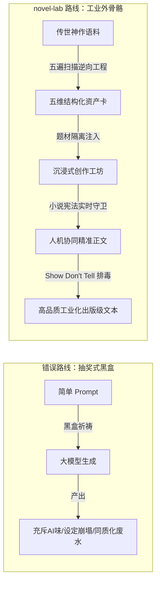
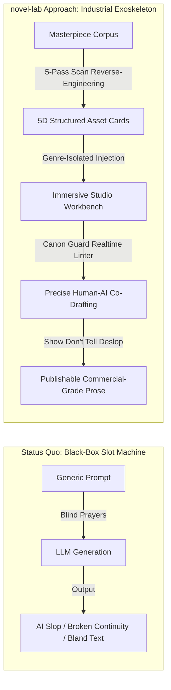

# novel-lab 核心理念设定与最高工程宪章
# 暮冬念春 / Exoscribe · Core Philosophy & Supreme Engineering Charter

> **官方品牌命名（正式确立）**：
> - **中文品牌名**：**暮冬念春**（寓意走出卡文断章与平庸 AI 的漫长寒冬，迎来传世史诗绽放的创作暖春）
> - **全球英文品牌名**：**Exoscribe**（Exoskeleton + Scribe，叙事外骨骼；副标题：*The Vernal Engine for Fiction*；品牌主张：*The Narrative Exoskeleton for Serious Storytellers*）
> - **工程代号 / Monorepo**：`novel-lab`
>
> **生效日期 / Effective Date**：2026-10-15  
> **版本 / Version**：v2.2.0  
> **适用对象 / Scope**：所有参与、维护、扩展 novel-lab（暮冬念春 / Exoscribe）的自主 Agent 与开发人员 / All Autonomous Agents and Developers  
> **效力等级 / Authority Level**：**最高级硬约束（工程思想宪法）/ Supreme Hard Constraint (Project Constitution)**  
> 
> [中文版本 (Chinese Version)](#一中文版本-chinese-version) | [English Version (英文版本)](#ii-english-version-英文版本)

---

# 一、中文版本 (Chinese Version)

## 0. 核心定位与终极愿景（Core Axiom）

### 0.1 终结“抽奖式 AI 写作”
市面上普遍的 AI 写作方案，本质上是在玩“抽奖老虎机”——给一个大框输入几句话，直接让大模型吐出一堆充斥着“眼中闪过一丝复杂”“深吸一口气”“然而不仅如此”的工业废水。前三章看似华丽，写到第十章设定崩塌、人物同质化、情节脱缰。

**系统（暮冬念春 / Exoscribe）的终极愿景**：
> **“终结抽奖式 AI 写作，用工业级逆向工程把传世文学的节奏与爽点拆成精准资产，让 AI 成为创作者的高精度外骨骼与严苛质检员，而不是制造平庸废话的打字机。”**



### 0.2 人机协同的角色定位法则
1. **人类作者是导演与灵魂**：负责注入最真实的痛苦、爱恨、审美与方向；作者的原始字符是神圣不可侵犯的。
2. **AI 是超级执行组与质检员**：负责铺陈细纲、检索桥段、推演暗线、查漏补缺，严格在设定的轨道内运转。
3. **系统是工业化底盘**：提供规范化的轨道，约束 AI 的幻觉，保卫作者的专注与创作主权。

---

## 1. 四大核心铁律（不可逾越的业务红线）

违反以下任意一条，产出物立即失去工程意义，CI 与门禁必须当场阻断：

### 铁律一 · 题材隔离（Genre Isolation）
* **【条文】**：不同题材的资产与配置必须严格物理隔离。聚合题材包时，`source_books` 的 genre 必须全部一致；不一致必须显式失败，**禁止静默跳过**。
* **【适用范围】**：题材包聚合（`pass5_aggregate.py`）、资产写入（`craft-card.meta.genre`）、桥段库（每条 trope 的 `genre_scope`）、检索/注入时的题材匹配。
* **【判定标准】**：`collect_books()` 返回的异题材书若被显式指定则必须 `sys.exit(1)`；`validate.py` 严格校验 `craft-card.meta.genre ∈ KNOWN_GENRES`；每条桥段必须标明属于 universal 还是题材专属 slug。
* **【理由】**：都市文的技法绝对不能污染玄幻修真，传统武侠的语域不能混进克苏鲁怪谈。混淆题材会让 Prompt 彻底失真，产出怪异平庸的四不像。
* **【预期作用】**：保证资产纯度，让每个题材包都是“单题材纯样本”。

### 铁律二 · 万字报告硬校验（10K Report Gate）
* **【条文】**：每本书的“拆书报告 + 笔法分析”**合计篇幅必须达标**：
  - **中文书籍**：合计字符数必须 $\ge$ **10,000 字符**（硬性下限门槛，字符数口径而非字节）；
  - **英文书籍**：合计词数必须 $\ge$ **5,000 英文单词（Words）**。
  篇幅不足即当场阻断交付。
* **【适用范围】**：所有进入 `reports/` 交付目录的分析报告。
* **【判定标准】**：单份报告不足仅作软告警，最终以 `report.py::check_combined_report_length` 合计为准。不合格者在写盘前直接拦截，**磁盘上一个字节都不许写入**。
* **【理由】**：“万字/5k词”是对创作者交付质量的下限承诺。几百字的泛泛空谈没有任何工程拆解价值。
* **【预期作用】**：杜绝半成品与应付性总结，确保进入知识库的解构内容具备真正的深度与参考厚度。

### 铁律三 · 纯标准库零第三方依赖（Zero Third-party Dependencies）
* **【条文】**：`scripts/` 与 `gui/` 后端**只能使用 Python 3.13 标准库**（`sqlite3`、`json`、`http.server`、`ctypes`、`pathlib` 等）。
* **【适用范围】**：所有 Python 业务核心、服务层、适配层与脚本。前端 Vite/React 与 Electron 构建脚本除外。
* **【判定标准】**：`tests/test_stdlib_only.py` 扫描 AST import 白名单全绿；CI 的 `ruff check .` 无新增依赖；严禁引入 `psutil`、`requests`、`fastapi` 等任何三方库。
* **【理由】**：这是客户端便携版（绿色解压即用）和安装包能够内置 Python 运行时、用户完全免配置环境的基础，也是保障系统轻量可靠、规避供应链安全风险的根基。
* **【预期作用】**：用户双击即可运行，永不因缺少 pip 依赖或版本冲突而崩溃。

### 铁律四 · 语料极高品质准入（High-Quality Corpus Integrity）
* **【条文】**：**所有拿过来使用的书籍，必须是质量极高的书籍**。严禁劣质断章、机器翻译、生僻碎片及无参考价值的小说充数。
* **【适用范围】**：本地语料库注册（`books` 表及 `corpus/` 目录）、小说精华库（`essence_books` / `essence_assets` / `essence_chains`）、拆书分析全链路。
* **【判定标准】**：
  1. 必须为经受过市场或文学检验的经典传世神作或公认代表作；
  2. **体量硬性门槛**：
     - **中文书籍**：单本正文字数必须 $\ge$ **300,000 字**，总章节数 $\ge$ **60 章**，平均章字数处于 **1,500 ~ 4,000 字**；
     - **英文书籍**：单本正文词数必须 $\ge$ **100,000 英文单词（Words）**，总章节数 $\ge$ **40 章**，平均单章处于 **2,000 ~ 4,000 单词**；
  3. 严禁导入无名碎片网文（`book_%` 垃圾语料一律拦截或清理）；
  4. 精华库必须配齐五维解构资产（骨架大纲、开篇钩子、反差人设、爆款桥段、反AI文风）与伏笔暗线。
* **【理由】**：劣质低俗的网文语料会严重污染文风卡与桥段库，误导 AI 生成充满烂俗套路与假大空废话的垃圾文本，彻底摧毁辅助创作的专业价值。
* **【预期作用】**：确保系统内沉淀的每一张资产卡、每一段文风、每一个桥段均来自顶级经典，建立真正的高价值文学经验库。

---

## 2. 创作者主权与安全守则（Author Sovereignty）

> [!CAUTION]
> ### 守则一：小说正文绝对禁止覆盖原文（Draft Protection）
> 创作者的每一个字符都是其知识产权与心血。
> - 任何 AI 改写、润色、排毒、扩写的产物，**必须另存为新的草稿文件或衍生版本**（例如 `《书名》修改稿_v1`）。
> - **绝对禁止**在没有用户逐句审核确认的前提下静默覆写原始 TXT / Markdown 稿件。

> [!IMPORTANT]
> ### 守则二：本地优先与数据完全私有（Local-First & Privacy）
> - 所有大纲、人设、正文手稿全部持久化保存在用户本地磁盘（`%LOCALAPPDATA%\暮冬念春\index.db` 与 `novel/`）。
> - 绝不强制要求云端同步，绝不暗中上传创作者的大纲手稿，不留任何数据后门。

> [!WARNING]
> ### 守则三：破坏性指令显式确认（Destruction Safety）
> - 任何删除文件、覆盖配置、`git reset --hard`、`git push -f` 强推、清空数据库或卸载软件的动作，**必须获得操作者的显式授权**，禁止私自执行。

---

## 3. 文学工学与反 AI 味标准（Anti-Slop & Craftsmanship）

系统不仅是存储软件，更是反抗平庸文本的守卫者：

### 3.1 贯彻“Show, Don't Tell”（用演的，别用喊的）
* 拒绝直白的抽象情绪喊话（如“他非常愤怒”“林晨感到前所未有的绝望”）。
* 强迫通过**生理微反应**（瞳孔骤缩、指节发白、倒吸一口冷气）、**动作细节**与**潜台词**展现情绪。

### 3.2 严禁六大典型 AI 腔调（Deslop 诊断红线）
1. **假大空修辞堆砌**：如“仿佛跨越了万古长河”“空气中弥漫着凝重的气息”；
2. **同义反复与车轱辘话**：一句话换三个词重复同一个意思；
3. **同构排比与段落行数对仗**：像阅兵式一样行数完全对齐的机械美感；
4. **句号当顿号**：为了制造所谓的“节奏感”强行切碎句子；
5. **极端程度副词泛滥**：无休止的“无比”“极其”“近乎于”“前所未有”；
6. **无意识口癖与陈述套路**：“深吸一口气”“然而不仅如此”“苦涩一笑”。

### 3.3 小说宪法守卫（Canon Guard）
* 每部作品必须树立其“正典宪法”：确定物理法则、力量体系阶梯与角色声线红线。
* 严禁在修仙历史中出现现代科学概念穿帮，严禁冷酷稳健主角说出轻浮网梗。

---

## 4. 架构与工程实现纪律（Engineering Rigor）

### 4.1 校验先于不可逆副作用（Validate Before Side-effects）
* 任何生成、导出、迁移逻辑，必须遵循：`内存计算/组装 → 严格门禁校验 → 校验通过才写盘`。
* 严禁“先写盘、后校验”。一旦校验失败，磁盘上不得残留任何半成品或临时文件。

### 4.2 运行时路径实时动态求值（Dynamic Paths）
* 一切运行时路径必须**在函数内部实时求值**（例如 `config.STATE_ROOT / "index.db"`）。
* **禁止**定义模块级路径常量（如 `_FILE = config.STATE_ROOT / "a.json"`），导入期快照会导致测试重定向隔离失效，严重污染用户真实生产数据。

### 4.3 编码兼容口径（Encoding Integrity）
* 正文读取与质检全链路严格执行 **“UTF-8 优先，失败自动退回 GBK”**（`scripts/chapter_loader.py` 与 `gui/text_access.py` 单一实现）。
* 坚决剔除 UTF-8 BOM 头，严防因编码问题误报为“读取失败”或导致首章标题丢失。

### 4.4 程序与用户数据严格物理分离（Data Isolation）
* 程序主安装目录（`%LOCALAPPDATA%\Programs\novel-lab-desktop`）与用户运行时数据目录（`%LOCALAPPDATA%\暮冬念春`）严格隔离。
* 无论安装、覆盖升级或卸载，用户数据目录必须得到完整无损保留。

### 4.5 确定性指标单真相源（Single Source of Truth）
* **拒绝口径漂移与虚假断言**：测试用例数、版本号、API 端点数必须由测试套件（`test_doc_metrics.py` 和 `test_version_consistency.py`）实时反射刚性锁定。
* 严禁在不同文档中复制粘贴写死的测试数字，所有口径以 `AGENTS.md §7` 的实测输出为唯一权威。

### 4.6 接口防御与目录穿越清洗（Sanitize All Inputs）
* 所有接收 `project`、`book_id`、`path` 等参数的服务层入口，必须使用 `_sanitize_project` 强制清洗，拦截 `..`、斜杠及非法控制字符。
* 严格阻断向系统预留的只读 `default` 项目写入业务数据。

---

## 5. 版本发布与交付铁则（Release Discipline）

响应创作者对“安装包必须依次递增版本、绝不混淆同版本”的严格要求：

1. **版本号单向严格递增（SemVer Strict Bump）**：
   * 任何正式特性提交或交付，必须按规则升级语义化版本（如 `2.1.0` $\to$ `2.2.0` $\to$ `2.3.0`），坚决杜绝覆盖同版本安装包。
2. **六点同步刚性守卫（Six-Point Atomic Sync）**：
   递增版本必须原子化同步以下 6 处位置，少一处测试即自动红牌报错：
   1. `gui/__init__.py::__version__`（唯一权威定义）
   2. `desktop/package.json::version`
   3. `gui/web/package.json::version`
   4. `gui/web/src/layout/WorkbenchNav.tsx`（界面展示）
   5. `build/installer.iss::AppVersion`
   6. `AGENTS.md` §7（当前实测口径行）
3. **闭环交付与哈希自证（Verified Release Loop）**：
   * 提交推送 $\to$ GitHub Actions 云端构建 $\to$ 自动化拉取 $\to$ 校验 SHA256 哈希 $\to$ 静默升级覆盖用户桌面。
   * 发版报告中必须据实汇报真实构建 Run ID、产物文件大小与 SHA256 指纹。

---

## 6. Agent 裁决与处置准则

当后续 Agent 遇到设计冲突或不确定场景时，按以下优先级裁决：

```
创作者原文安全 > 极高品质语料铁律 > 零依赖与题材隔离 > 确定性测试门禁 > 新增功能特性
```

* **诚实是最高准则**：没读过的文件不引用其内容，没跑过的命令不声称其输出，没验证过的不说“已生效”。
* **发现违背宪章的代码时**：立即原地修复，补充回归测试守卫，绝不姑息凑合。

---
---

# II. English Version (英文版本)

## 0. Core Axiom & Ultimate Vision

### 0.1 Ending "Slot-Machine AI Writing"
Most contemporary AI writing solutions operate like gambling slot machines: the user inputs a vague prompt into a generic text box, and the Large Language Model regurgitates gallons of homogenous AI slop filled with stale clichés ("a flicker of complexity flashed across his eyes", "took a deep breath", "however, not only that"). The first three chapters look polished, but by chapter ten, the world-building collapses, character voices dissolve into uniformity, and the plot derails uncontrollably.

**The Ultimate Vision of novel-lab**:
> **"To eradicate slot-machine AI generation by reverse-engineering classical web novel masterpieces into reusable structural assets, transforming AI into a high-precision creative exoskeleton and uncompromising quality inspector—never a typewriter for mediocre slop."**



### 0.2 The Tripartite Paradigm of Human-AI Collaboration
1. **The Human Author is the Director and Soul**: Responsible for genuine emotional suffering, passion, aesthetics, and creative direction. The author's original words are sacred and inviolable.
2. **The AI is the Execution Crew and Quality Inspector**: Responsible for breaking down chapter outlines, retrieving tropes, tracing foreshadowing chains, and flagging inconsistencies strictly within prescribed boundary tracks.
3. **The System is the Industrial Chassis**: Providing deterministic rails that constrain model hallucinations, protect authorial focus, and safeguard data sovereignty.

---

## 1. The Four Core Iron Laws (Non-Negotiable Red Lines)

Violation of any of the following rules immediately renders deliverables invalid; CI pipelines and pre-commit gates must block execution instantly:

### Iron Law 1 · Genre Isolation
* **【Statute】**: Assets and configurations across different genres must be strictly physically isolated. When aggregating a genre pack, the `genre` of all `source_books` must be completely identical. Any mismatch must fail explicitly; **silent skipping is strictly forbidden**.
* **【Scope】**: Genre pack aggregation (`pass5_aggregate.py`), asset writes (`craft-card.meta.genre`), trope libraries (trope `genre_scope`), and retrieval/injection prompt generation.
* **【Criteria】**: Mismatched books explicitly targeted in `collect_books()` must trigger `sys.exit(1)`. `validate.py` strictly enforces `craft-card.meta.genre ∈ KNOWN_GENRES`. Every trope must explicitly declare whether it is `universal` or a genre-specific slug.
* **【Rationale】**: Urban drama pacing must never contaminate Xianxia cultivation; traditional Wuxia prose must not bleed into Lovecraftian horror. Genre bleeding produces bizarre, bland, and disorienting prose.
* **【Intended Effect】**: Guarantees pure, single-genre benchmark training and reference sets.

### Iron Law 2 · 10,000-Character Combined Report Hard Gate
* **【Statute】**: For every analyzed book, the **combined character count** of the Deconstruction Report and Craft Analysis **must be $\ge$ 10,000 Chinese characters** (hard minimum threshold; measured by characters, not bytes). Falling short blocks delivery.
* **【Scope】**: All deliverable analysis reports entering the `reports/` directory.
* **【Criteria】**: Single reports under 10k trigger only a soft warning; enforcement relies on the sum via `report.py::check_combined_report_length`. Unqualified reports are intercepted prior to disk write: **not a single byte may touch the disk**.
* **【Rationale】**: "10,000 characters" is our contractual baseline quality promise. Superficial multi-paragraph summaries hold zero engineering value.
* **【Intended Effect】**: Eliminates half-baked summaries; guarantees that all deconstructed assets possess actionable depth.

### Iron Law 3 · Zero Third-Party Dependencies (Pure Standard Library)
* **【Statute】**: The backend under `scripts/` and `gui/` **must exclusively use the Python 3.13 Standard Library** (`sqlite3`, `json`, `http.server`, `ctypes`, `pathlib`, etc.).
* **【Scope】**: All Python business logic, services, adapters, and scripts. Excludes frontend Vite/React code and Electron build tools.
* **【Criteria】**: `tests/test_stdlib_only.py` AST scanner passes 100% against the import whitelist. CI `ruff check .` reports zero new dependencies. Introducing packages like `psutil`, `requests`, or `fastapi` is strictly prohibited.
* **【Rationale】**: This guarantees portable releases and desktop installers can bundle an embedded Python runtime, giving users zero-configuration, double-click execution while minimizing supply-chain attack surfaces.
* **【Intended Effect】**: Works reliably out of the box on any clean Windows machine without `pip install` failures or environment corruption.

### Iron Law 4 · High-Quality Corpus Integrity
* **【Statute】**: **All books brought in and utilized must be of exceptionally high quality**. Fragmented chapters, machine translations, obscure fragments, and low-value web novel filler are strictly barred from entering the system.
* **【Scope】**: Local corpus registration (`books` table and `corpus/` folder), Novel Essence Library (`essence_books` / `essence_assets` / `essence_chains`), and the entire deconstruction pipeline.
* **【Criteria】**:
  1. Books must be market-tested or critically acclaimed canonical Chinese original long-form web novels or literary milestones;
  2. Total word count must be $\ge$ **300,000 characters**, total chapters $\ge$ **60**, with an average chapter length of **1,500 ~ 4,000 characters**;
  3. Importing unverified, fragmented text is forbidden (`book_%` garbage batches must be blocked or purged);
  4. Essence entries must provide complete 5D assets (Core Outline, Opening Hook, Contrasting Persona, Climax Trope, Anti-AI Style) and Foreshadowing Chains.
* **【Rationale】**: Inferior web novel filler pollutes style cards and trope libraries, inducing AI models to mimic vulgar tropes and empty prose, destroying the tool's professional value.
* **【Intended Effect】**: Ensures that every card, trope, and foreshadowing pattern originates from top-tier literary craftsmanship.

---

## 2. Author Sovereignty & Safety Code

> [!CAUTION]
> ### Rule 1: Never Overwrite Original Manuscripts (Draft Protection)
> Every word typed by the author represents intellectual property and labor.
> - Any text generated by AI rewriting, polishing, deslopping, or expansion **must be saved as a separate draft or revision** (e.g., `Book_Revision_v1`).
> - **Silent or automated overwriting of raw TXT / Markdown manuscript files is strictly forbidden.**

> [!IMPORTANT]
> ### Rule 2: Local-First & Complete Data Privacy
> - Outlines, characters, and manuscripts are stored locally on the user's disk (`%LOCALAPPDATA%\暮冬念春\index.db` and `novel/`).
> - Cloud synchronization is never mandatory; author manuscripts are never uploaded secretly; no telemetry backdoors exist.

> [!WARNING]
> ### Rule 3: Explicit Confirmation for Destructive Actions
> - File deletions, configuration overwrites, `git reset --hard`, `git push -f`, database truncations, or application uninstalls **must receive explicit user authorization** prior to execution.

---

## 3. Literary Engineering & Anti-Slop Standards

novel-lab is both a writing workshop and a relentless defender against mediocre prose:

### 3.1 Enforcing "Show, Don't Tell"
* Reject abstract, direct emotional declarations (e.g., "he was extremely angry", "Lin Chen felt unprecedented despair").
* Force emotions to be expressed through **physiological micro-reactions** (dilated pupils, blanching knuckles, sharp intake of breath), **action beats**, and **subtext**.

### 3.2 Eradicating the Six Hallmarks of AI Slop
1. **Empty, Grandiose Rhetoric**: "as if crossing the eternal river of time", "a heavy tension hung in the air";
2. **Tautological Repetition**: Saying the exact same idea three times with synonymous phrasing;
3. **Mechanical Isomorphic Symmetry**: Overly balanced sentence structures and identical paragraph line lengths;
4. **Choppy Punctuation Staccato**: Splitting natural sentences with excessive periods to mimic dramatic tension;
5. **Superlative Adverb Overuse**: Chronic reliance on "unprecedented", "infinitely", "utterly", "beyond measure";
6. **Unconscious Verbal Tics**: "took a deep breath", "however, not only that", "a bitter smile".

### 3.3 Canon Guard
* Every project must define its own Canon Constitution: setting firm physical laws, power scaling tiers, and character voice boundaries.
* Xianxia or historical narratives must never slip into modern scientific terminology; stoic, cold characters must never use flippant internet memes.

---

## 4. Architectural & Engineering Rigor

### 4.1 Validate Before Irreversible Side-Effects
* Generation, export, and migration logic must follow: `In-Memory Assembly → Strict Validation Gate → Write to Disk only upon Passing`.
* Never write to disk first and validate second. If validation fails, zero partial or corrupted artifacts may remain on disk.

### 4.2 Dynamic Runtime Path Evaluation
* All runtime paths must be **evaluated dynamically inside function bodies** (e.g., `config.STATE_ROOT / "index.db"`).
* **Module-level path constants are prohibited** (e.g., `_FILE = config.STATE_ROOT / "a.json"`). Import-time snapshots break test isolation and lead to accidental corruption of real user data.

### 4.3 Robust Encoding Pipeline
* Text reading and inspection must enforce: **"UTF-8 first, automatic fallback to GBK"** (`scripts/chapter_loader.py` and `gui/text_access.py`).
* UTF-8 BOM markers must be stripped cleanly to prevent false "read errors" or dropped chapter titles.

### 4.4 Physical Separation of App & User Data
* The program binary directory (`%LOCALAPPDATA%\Programs\novel-lab-desktop`) and the runtime user data directory (`%LOCALAPPDATA%\暮冬念春`) must remain strictly physically segregated.
* Installing, upgrading, or uninstalling the application must never erase or modify user database files.

### 4.5 Deterministic Single Source of Truth
* **Zero tolerance for metric drift**: Backend test counts, canonical version numbers, and API endpoint tallies must be asserted dynamically by automated tests (`test_doc_metrics.py` and `test_version_consistency.py`).
* Hardcoded metric numbers across multiple documentation files are forbidden; metrics in `AGENTS.md §7` represent the sole authoritative truth.

### 4.6 Input Sanitization & Traversal Defense
* Any service endpoint taking `project`, `book_id`, or `path` must route inputs through `_sanitize_project` to block `..`, path delimiters, and control characters.
* Writing user data to the reserved read-only `default` project is strictly blocked.

---

## 5. Release & Versioning Discipline

In compliance with the mandatory requirement that "all installer releases must strictly increment versions without reuse":

1. **Strict Monotonic SemVer Bumping**:
   * Every formal release must increment the semantic version (e.g., `2.1.0` $\to$ `2.2.0` $\to$ `2.3.0`). Releasing updated binaries under an identical version number is strictly prohibited.
2. **Atomic Six-Point Synchronization**:
   Version bumps must simultaneously update the following 6 locations; missing a single one triggers an immediate test failure:
   1. `gui/__init__.py::__version__` (Canonical Source)
   2. `desktop/package.json::version`
   3. `gui/web/package.json::version`
   4. `gui/web/src/layout/WorkbenchNav.tsx` (UI Display)
   5. `build/installer.iss::AppVersion`
   6. `AGENTS.md` §7 (Authoritative Metric Line)
3. **Closed-Loop Verified Delivery**:
   * Git Commit & Push $\to$ GitHub Actions Cloud Build $\to$ Automated Pull $\to$ SHA256 Verification $\to$ Silent Desktop Upgrade.
   * Release reports must report the exact GitHub Actions Run ID, binary byte size, and SHA256 fingerprint.

---

## 6. Agent Arbitration Hierarchy

When future autonomous Agents encounter architectural conflicts or ambiguity, resolve them using this strict hierarchy:

```
Author Manuscript Safety > High-Quality Corpus Integrity > Zero Dependencies & Genre Isolation > Deterministic Test Gates > New Feature Requests
```

* **Honesty is the Supreme Virtue**: Never cite unread files; never claim unverified test outputs; never report an unvalidated feature as "functioning".
* **When discovering non-compliant code**: Remediate it immediately at the root, append regression tests, and never settle for temporary workarounds.
