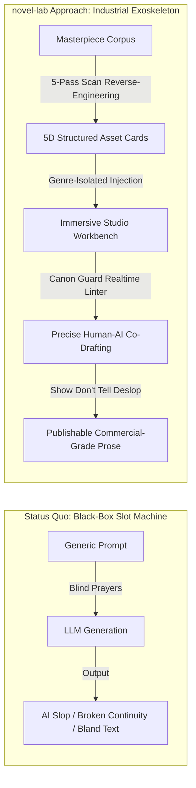

# Core Philosophy & Supreme Engineering Charter

> **Effective Date**: 2026-10-14  
> **Version**: v2.2.0  
> **Target Audience**: All Autonomous Agents and Developers maintaining or extending novel-lab  
> **Authority Level**: **Supreme Hard Constraint (Project Constitution)**. Any code modification, feature addition, or corpus onboarding that violates this charter is deemed a **P0 Critical Bug** requiring immediate remediation or rollback.  
> 
> *Corresponding Chinese Charter: [CORE_PHILOSOPHY.md](CORE_PHILOSOPHY.md)*

---

## 0. Core Axiom & Ultimate Vision

### 0.1 Ending "Slot-Machine AI Writing"
Most contemporary AI writing solutions operate like gambling slot machines: the user inputs a vague prompt into a generic text box, and the Large Language Model regurgitates gallons of homogenous AI slop filled with stale clichés ("a flicker of complexity flashed across his eyes", "took a deep breath", "however, not only that"). The first three chapters look polished, but by chapter ten, the world-building collapses, character voices dissolve into uniformity, and the plot derails uncontrollably.

**The Ultimate Vision of novel-lab (暮冬念春)**:
> **"To eradicate slot-machine AI generation by reverse-engineering classical web novel masterpieces into reusable structural assets, transforming AI into a high-precision creative exoskeleton and uncompromising quality inspector—never a typewriter for mediocre slop."**



### 0.2 The Tripartite Paradigm of Human-AI Collaboration
1. **The Human Author is the Director and Soul**: Responsible for genuine emotional suffering, passion, aesthetics, and creative direction. The author's original words are sacred and inviolable.
2. **The AI is the Execution Crew and Quality Inspector**: Responsible for breaking down chapter outlines, retrieving tropes, tracing foreshadowing chains, and flagging inconsistencies strictly within prescribed boundary tracks.
3. **The System is the Industrial Chassis**: Providing deterministic rails that constrain model hallucinations, protect authorial focus, and safeguard data sovereignty.

---

## 1. The Four Core Iron Laws (Non-Negotiable Red Lines)

Violation of any of the following rules immediately renders deliverables invalid; CI pipelines and pre-commit gates must block execution instantly:

### Iron Law 1 · Genre Isolation
* **【Statute】**: Assets and configurations across different genres must be strictly physically isolated. When aggregating a genre pack, the `genre` of all `source_books` must be completely identical. Any mismatch must fail explicitly; **silent skipping is strictly forbidden**.
* **【Scope】**: Genre pack aggregation (`pass5_aggregate.py`), asset writes (`craft-card.meta.genre`), trope libraries (trope `genre_scope`), and retrieval/injection prompt generation.
* **【Criteria】**: Mismatched books explicitly targeted in `collect_books()` must trigger `sys.exit(1)`. `validate.py` strictly enforces `craft-card.meta.genre ∈ KNOWN_GENRES`. Every trope must explicitly declare whether it is `universal` or a genre-specific slug.
* **【Rationale】**: Urban drama pacing must never contaminate Xianxia cultivation; traditional Wuxia prose must not bleed into Lovecraftian horror. Genre bleeding produces bizarre, bland, and disorienting prose.
* **【Intended Effect】**: Guarantees pure, single-genre benchmark training and reference sets.

### Iron Law 2 · 10,000-Character Combined Report Hard Gate
* **【Statute】**: For every analyzed book, the **combined character count** of the Deconstruction Report and Craft Analysis **must be $\ge$ 10,000 Chinese characters** (hard minimum threshold; measured by characters, not bytes). Falling short blocks delivery.
* **【Scope】**: All deliverable analysis reports entering the `reports/` directory.
* **【Criteria】**: Single reports under 10k trigger only a soft warning; enforcement relies on the sum via `report.py::check_combined_report_length`. Unqualified reports are intercepted prior to disk write: **not a single byte may touch the disk**.
* **【Rationale】**: "10,000 characters" is our contractual baseline quality promise. Superficial multi-paragraph summaries hold zero engineering value.
* **【Intended Effect】**: Eliminates half-baked summaries; guarantees that all deconstructed assets possess actionable depth.

### Iron Law 3 · Zero Third-Party Dependencies (Pure Standard Library)
* **【Statute】**: The backend under `scripts/` and `gui/` **must exclusively use the Python 3.13 Standard Library** (`sqlite3`, `json`, `http.server`, `ctypes`, `pathlib`, etc.).
* **【Scope】**: All Python business logic, services, adapters, and scripts. Excludes frontend Vite/React code and Electron build tools.
* **【Criteria】**: `tests/test_stdlib_only.py` AST scanner passes 100% against the import whitelist. CI `ruff check .` reports zero new dependencies. Introducing packages like `psutil`, `requests`, or `fastapi` is strictly prohibited.
* **【Rationale】**: This guarantees portable releases and desktop installers can bundle an embedded Python runtime, giving users zero-configuration, double-click execution while minimizing supply-chain attack surfaces.
* **【Intended Effect】**: Works reliably out of the box on any clean Windows machine without `pip install` failures or environment corruption.

### Iron Law 4 · High-Quality Corpus Integrity
* **【Statute】**: **All books brought in and utilized must be of exceptionally high quality**. Fragmented chapters, machine translations, obscure fragments, and low-value web novel filler are strictly barred from entering the system.
* **【Scope】**: Local corpus registration (`books` table and `corpus/` folder), Novel Essence Library (`essence_books` / `essence_assets` / `essence_chains`), and the entire deconstruction pipeline.
* **【Criteria】**:
  1. Books must be market-tested or critically acclaimed canonical Chinese original long-form web novels or literary milestones;
  2. Total word count must be $\ge$ **300,000 characters**, total chapters $\ge$ **60**, with an average chapter length of **1,500 ~ 4,000 characters**;
  3. Importing unverified, fragmented text is forbidden (`book_%` garbage batches must be blocked or purged);
  4. Essence entries must provide complete 5D assets (Core Outline, Opening Hook, Contrasting Persona, Climax Trope, Anti-AI Style) and Foreshadowing Chains.
* **【Rationale】**: Inferior web novel filler pollutes style cards and trope libraries, inducing AI models to mimic vulgar tropes and empty prose, destroying the tool's professional value.
* **【Intended Effect】**: Ensures that every card, trope, and foreshadowing pattern originates from top-tier literary craftsmanship.

---

## 2. Author Sovereignty & Safety Code

> [!CAUTION]
> ### Rule 1: Never Overwrite Original Manuscripts (Draft Protection)
> Every word typed by the author represents intellectual property and labor.
> - Any text generated by AI rewriting, polishing, deslopping, or expansion **must be saved as a separate draft or revision** (e.g., `Book_Revision_v1`).
> - **Silent or automated overwriting of raw TXT / Markdown manuscript files is strictly forbidden.**

> [!IMPORTANT]
> ### Rule 2: Local-First & Complete Data Privacy
> - Outlines, characters, and manuscripts are stored locally on the user's disk (`%LOCALAPPDATA%\暮冬念春\index.db` and `novel/`).
> - Cloud synchronization is never mandatory; author manuscripts are never uploaded secretly; no telemetry backdoors exist.

> [!WARNING]
> ### Rule 3: Explicit Confirmation for Destructive Actions
> - File deletions, configuration overwrites, `git reset --hard`, `git push -f`, database truncations, or application uninstalls **must receive explicit user authorization** prior to execution.

---

## 3. Literary Engineering & Anti-Slop Standards

novel-lab is both a writing workshop and a relentless defender against mediocre prose:

### 3.1 Enforcing "Show, Don't Tell"
* Reject abstract, direct emotional declarations (e.g., "he was extremely angry", "Lin Chen felt unprecedented despair").
* Force emotions to be expressed through **physiological micro-reactions** (dilated pupils, blanching knuckles, sharp intake of breath), **action beats**, and **subtext**.

### 3.2 Eradicating the Six Hallmarks of AI Slop
1. **Empty, Grandiose Rhetoric**: "as if crossing the eternal river of time", "a heavy tension hung in the air";
2. **Tautological Repetition**: Saying the exact same idea three times with synonymous phrasing;
3. **Mechanical Isomorphic Symmetry**: Overly balanced sentence structures and identical paragraph line lengths;
4. **Choppy Punctuation Staccato**: Splitting natural sentences with excessive periods to mimic dramatic tension;
5. **Superlative Adverb Overuse**: Chronic reliance on "unprecedented", "infinitely", "utterly", "beyond measure";
6. **Unconscious Verbal Tics**: "took a deep breath", "however, not only that", "a bitter smile".

### 3.3 Canon Guard
* Every project must define its own Canon Constitution: setting firm physical laws, power scaling tiers, and character voice boundaries.
* Xianxia or historical narratives must never slip into modern scientific terminology; stoic, cold characters must never use flippant internet memes.

---

## 4. Architectural & Engineering Rigor

### 4.1 Validate Before Irreversible Side-Effects
* Generation, export, and migration logic must follow: `In-Memory Assembly → Strict Validation Gate → Write to Disk only upon Passing`.
* Never write to disk first and validate second. If validation fails, zero partial or corrupted artifacts may remain on disk.

### 4.2 Dynamic Runtime Path Evaluation
* All runtime paths must be **evaluated dynamically inside function bodies** (e.g., `config.STATE_ROOT / "index.db"`).
* **Module-level path constants are prohibited** (e.g., `_FILE = config.STATE_ROOT / "a.json"`). Import-time snapshots break test isolation and lead to accidental corruption of real user data.

### 4.3 Robust Encoding Pipeline
* Text reading and inspection must enforce: **"UTF-8 first, automatic fallback to GBK"** (`scripts/chapter_loader.py` and `gui/text_access.py`).
* UTF-8 BOM markers must be stripped cleanly to prevent false "read errors" or dropped chapter titles.

### 4.4 Physical Separation of App & User Data
* The program binary directory (`%LOCALAPPDATA%\Programs\novel-lab-desktop`) and the runtime user data directory (`%LOCALAPPDATA%\暮冬念春`) must remain strictly physically segregated.
* Installing, upgrading, or uninstalling the application must never erase or modify user database files.

### 4.5 Deterministic Single Source of Truth
* **Zero tolerance for metric drift**: Backend test counts, canonical version numbers, and API endpoint tallies must be asserted dynamically by automated tests (`test_doc_metrics.py` and `test_version_consistency.py`).
* Hardcoded metric numbers across multiple documentation files are forbidden; metrics in `AGENTS.md §7` represent the sole authoritative truth.

### 4.6 Input Sanitization & Traversal Defense
* Any service endpoint taking `project`, `book_id`, or `path` must route inputs through `_sanitize_project` to block `..`, path delimiters, and control characters.
* Writing user data to the reserved read-only `default` project is strictly blocked.

---

## 5. Release & Versioning Discipline

In compliance with the mandatory requirement that "all installer releases must strictly increment versions without reuse":

1. **Strict Monotonic SemVer Bumping**:
   * Every formal release must increment the semantic version (e.g., `2.1.0` $\to$ `2.2.0` $\to$ `2.3.0`). Releasing updated binaries under an identical version number is strictly prohibited.
2. **Atomic Six-Point Synchronization**:
   Version bumps must simultaneously update the following 6 locations; missing a single one triggers an immediate test failure:
   1. `gui/__init__.py::__version__` (Canonical Source)
   2. `desktop/package.json::version`
   3. `gui/web/package.json::version`
   4. `gui/web/src/layout/WorkbenchNav.tsx` (UI Display)
   5. `build/installer.iss::AppVersion`
   6. `AGENTS.md` §7 (Authoritative Metric Line)
3. **Closed-Loop Verified Delivery**:
   * Git Commit & Push $\to$ GitHub Actions Cloud Build $\to$ Automated Pull $\to$ SHA256 Verification $\to$ Silent Desktop Upgrade.
   * Release reports must report the exact GitHub Actions Run ID, binary byte size, and SHA256 fingerprint.

---

## 6. Agent Arbitration Hierarchy

When future autonomous Agents encounter architectural conflicts or ambiguity, resolve them using this strict hierarchy:

```
Author Manuscript Safety > High-Quality Corpus Integrity > Zero Dependencies & Genre Isolation > Deterministic Test Gates > New Feature Requests
```

* **Honesty is the Supreme Virtue**: Never cite unread files; never claim unverified test outputs; never report an unvalidated feature as "functioning".
* **When discovering non-compliant code**: Remediate it immediately at the root, append regression tests, and never settle for temporary workarounds.
