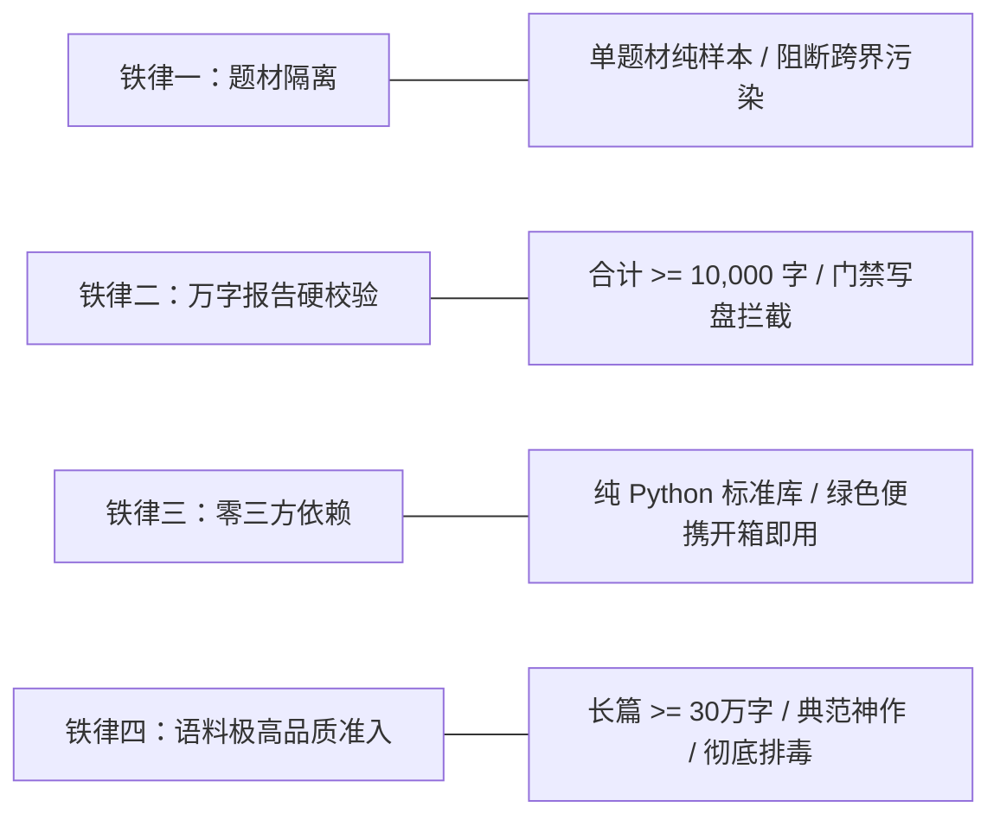
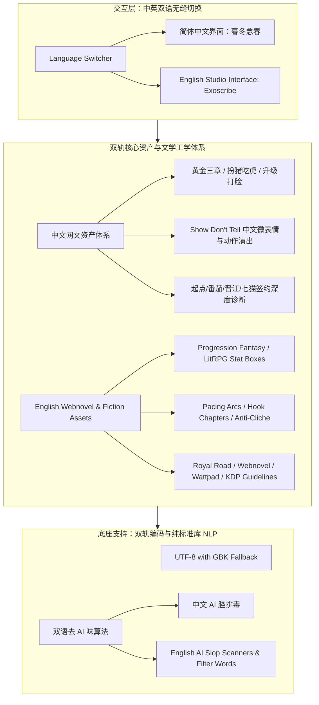
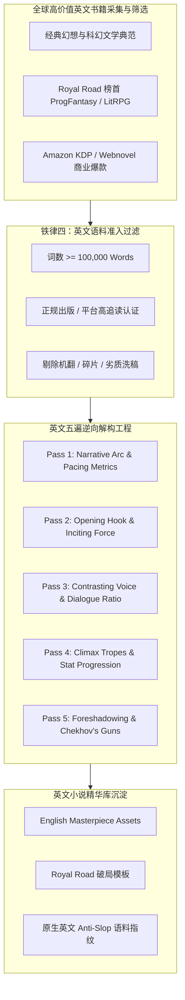
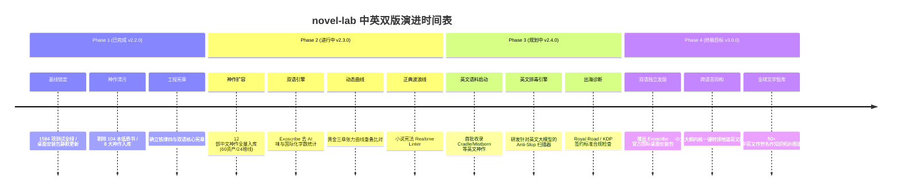

# 暮冬念春 / Exoscribe 核心理念设定、研发进度与中英文双版未来规划全书
# Master Blueprint: Philosophy, Baseline Progress & Global Internationalization

> **官方品牌命名（正式确立）**：
> - **中文品牌名**：**暮冬念春**（寓意走出卡文断章与平庸 AI 的漫长寒冬，迎来传世史诗绽放的创作暖春）
> - **全球英文品牌名**：**Exoscribe**（Exoskeleton + Scribe，叙事外骨骼；副标题：*The Vernal Engine for Fiction*；品牌主张：*The Narrative Exoskeleton for Serious Storytellers*）
> - **工程代号 / Monorepo**：`novel-lab`
>
> **编制时间**：2026-10-15  
> **当前工程基线**：v2.2.0（后端单测 1612 项全通 ｜ 前端测试 144 项全通 ｜ API 端点 130 个）  
> **文件定位**：全景式战略白皮书，涵盖**核心理念哲学**、**中英文双版规划**、**当前项目进度实录**与**全球英文书籍收录及分析路线图**。

---

## 目录
1. [底层愿景与核心理念体系](#1-底层愿景与核心理念体系)
2. [四大核心业务铁律与创作者主权](#2-四大核心业务铁律与创作者主权)
3. [版本规划：中英文双版与 Exoscribe 国际化战略](#3-版本规划中英文双版与-exoscribe-国际化战略)
4. [项目实录：当前研发进度与落地现状](#4-项目实录当前研发进度与落地现状)
5. [未来规划：全球英文书籍收集与深度解构体系](#5-未来规划全球英文书籍收集与深度解构体系)
6. [演进时间表与里程碑路线图](#6-演进时间表与里程碑路线图)

---

## 1. 底层愿景与核心理念体系

### 1.1 终结“抽奖式 AI 写作”
当前全球生成式 AI 辅助创作工具普遍陷入了**“老虎机抽奖困境”**：
- **黑盒祈祷**：在输入框内输入一段粗略的提示词，祈祷大模型生成期望的内容；
- **工业废水**：大模型倾向于生成极度平庸、充满“眼中闪过一丝复杂”“深吸一口气”“然而不仅如此”的陈词滥调；
- **长篇脱缰**：前三章看似华丽，写到第十章设定崩塌、角色声线同质化、核心伏笔遗忘失控。

**novel-lab 的核心理念**：
> **“终结抽奖式 AI 写作，用工业级逆向工程把传世文学的节奏与爽点拆成精准资产，让 AI 成为创作者的高精度外骨骼与严苛质检员，而不是制造平庸废话的打字机。”**


### 1.2 人机协同的角色定位法则
1. **人类作者是导演与灵魂**：负责注入最真实的痛苦、爱恨、审美与方向；作者的原始字符是神圣不可侵犯的。
2. **AI 是超级执行组与质检员**：负责铺陈细纲、检索桥段、推演暗线、查漏补缺，严格在设定的轨道内运转。
3. **系统是工业化底盘**：提供规范化的轨道，约束 AI 的幻觉，保卫作者的专注与创作主权。

---

## 2. 四大核心业务铁律与创作者主权

任何后续参与本项目的自主 Agent 或开发团队，必须无条件恪守以下四条铁律（已写入项目宪法 [CORE_PHILOSOPHY.md](CORE_PHILOSOPHY.md)）：



### 2.1 四大业务铁律
1. **铁律一 · 题材隔离（Genre Isolation）**：不同题材的资产与配置必须严格物理隔离。聚合题材包时 `source_books` 的题材必须百分之百一致，严禁都市技法污染玄幻修真，严禁传统武侠混入克苏鲁怪谈。
2. **铁律二 · 深度报告硬校验门禁（Combined Report Gate）**：
   - **中文书籍**：拆书报告 + 笔法分析合计字符数必须 $\ge$ **10,000 字符**；
   - **英文书籍**：拆书报告 + 笔法分析合计词数必须 $\ge$ **5,000 英文单词（Words）**。
   不达标者在写盘前强制硬拦截，磁盘上绝不写入半字节垃圾。
3. **铁律三 · 纯标准库零第三方依赖（Zero Third-party Dependencies）**：后端核心代码只允许使用 Python 3.13 原生标准库（`sqlite3`、`json`、`http.server`、`pathlib`、`ctypes` 等），坚决杜绝任何第三方 pip 污染，确保桌面安装包永不因外部依赖损坏。
4. **铁律四 · 语料极高品质准入（High-Quality Corpus Integrity）**：**所有拿过来使用的书籍，必须是质量极高的书籍**。
   - **中文书籍**：单本字数必须 $\ge 30$ 万字，章节 $\ge 60$ 章，平均单章 1,500 ~ 4,000 字；
   - **英文书籍**：单本词数必须 $\ge 100,000$ 英文单词（Words），章节 $\ge 40$ 章，平均单章 2,000 ~ 4,000 单词；
   必须具备完备的五维解构资产与伏笔暗线，坚决清理并杜绝无名碎片垃圾语料。

### 2.2 创作者主权三道红线
- **红线一（正文神圣不可侵犯）**：任何 AI 改写、润色、排毒、扩写产物，**一律另存为草稿副本**，绝对禁止静默覆写作者的原 TXT / Markdown 稿件。
- **红线二（本地优先与完全私有）**：数据全量存储在本地 SQLite 与磁盘，不依赖云端，不留任何数据暗门，绝不用创作者手稿训练任何 AI。
- **红线三（破坏性操作显式授权）**：删除、覆盖、重置、强推前必须经创作者明确确认。

---

## 3. 版本规划：中英文双版与 Exoscribe 国际化战略

为满足全球网络文学出海与海外作者的专业创作需求，本项目正式确立**“中英文双版（Bilingual Dual Editions）”**长期版本演进战略。

### 3.1 官方品牌命名正式锁定
- **中文品牌名**：**暮冬念春**
  - **内涵**：寓意走出卡文断章、创意枯竭与平庸 AI 泛滥的漫长寒冬，迎来传世长卷与史诗绽放的创作暖春。
- **全球英文品牌名**：**Exoscribe**
  - **词源**：**Exoskeleton（外骨骼）+ Scribe（著作家 / 记录史诗的书吏）**。
  - **副标题**：*The Vernal Engine for Fiction*（承接“念春”春意复苏之意）。
  - **品牌主张（Tagline）**：*"The Narrative Exoskeleton for Serious Storytellers."*（为严肃长篇创作者打造的叙事外骨骼）。
  - **定位**：明确向全球作家传递信号——这不是替你敲键盘的平庸 AI 打字机，而是赋能作者掌控长篇宏观结构、防崩塌、高承载的精密动力外骨骼。
- **工程代号 / Monorepo**：`novel-lab`。



### 3.2 界面与交互双语化（UI Internationalization）
- **统一轻量级 i18n 底座**：在保持纯前端零臃肿原则下，引入轻量级国际化词条管理；
- **全工作台覆盖**：
  - 创作大盘（Dashboard & Word Count Velocity）
  - 沉浸创作室（StudioView & Chapter Editor）
  - 质检排毒台（Quality & Poison & Deslop Workbench）
  - 小说精华库（Masterpiece Essence Explorer）
  - 灵感起名工坊（Inspiration & Name Generator）
- **一键切换**：支持在桌面端侧边栏自由无缝切换 `简体中文` 与 `English`。

### 3.3 双轨文学资产与工学体系
中文与英文网络小说的爽点机制、叙事惯性与读者审美存在显著差异，系统不搞“生硬机械翻译”，而是建立两套平行的文学工学模型：

| 维度 | 中文网文模式（Chinese Edition） | 英文网络文学模式（English Edition） |
|---|---|---|
| **核心爆款流派** | 玄幻修真、古典仙侠、都市异能、历史架空、悬疑怪谈 | Progression Fantasy、LitRPG（面板升级）、Urban Paranormal、Isekai / Portal |
| **开篇结构指标** | 黄金三章、入戏危机、金手指到账、首章断章悬念 | Hook Chapter、Inciting Incident、System Awakening、Call to Adventure |
| **高潮节拍模型** | 三段式打脸、压抑蓄水后决堤山洪爆发、反转逆袭 | Escalating Stakes、Boss Encounter、Loot / Stat Payoff、Cliffhanger |
| **平台对标审查** | 起点（设定与逻辑）、番茄（快节奏）、晋江（人设细腻） | Royal Road（硬核升级与世界观）、Webnovel（快节奏爽文）、Wattpad（情绪与人设）、Amazon KDP |
| **去 AI 味诊断重点** | 假大空修辞、同义反复、无来由排比、句号当顿号 | 英文大模型陈词滥调（"testament to", "delve", "tapestry", "shiver down spine"）与 Filter Words |

### 3.4 国际化工程底座补充清单
1. **海外出版与分发格式适配**：
   - **EPUB 3.0 原生标准容器导出**：满足 Amazon KDP 上架与个人独立出版（Self-Publishing）；
   - **Shunn 标准文稿格式（Standard Manuscript Format）**：满足向海外出版商和文学经纪人投稿规范；
   - **Royal Road 章节格式**：支持 Author's Notes（卷首卷尾作者说）与 BBCode / Markdown 混合排版。
2. **LitRPG 属性面板与状态栏渲染器（Stat Box Renderer）**：
   - 针对海外极度热门的 LitRPG / GameLit 分类，内置可视化的 Stat Box 语法解析与组件渲染，支持移动端自适应。
3. **英文专用 Anti-Slop 诊断引擎**：
   - **Filter Words 弱动词扫描**（*saw, felt, noticed, wondered* 等弱化代入感的过滤词）；
   - **过度副词扫描**（`-ly` 结尾的动作副词堆砌拦截）；
   - **典型 LLM 八股拦截**（*delve, tapestry, testament to, palpable tension* 等）。
4. **创作者数据主权与隐私护城河（Local-First Fortress）**：
   - 坚持“100% 本地优先、零遥测上传、绝不用创作者手稿训练 AI”，作为海外竞争的关键信任壁垒。

### 3.5 双版本独立发行与统一技术底座
- **单一代码库（Monorepo）**：后端保持纯 Python 标准库架构，统一处理中英双语的文本切分、倒排索引与数据持久化；
- **发版产物规划**：
  - `暮冬念春-Setup-win64.exe`：面向国内创作者的中文旗舰发行包（内置中英一键切换）；
  - `Exoscribe-Setup-win64.exe`：面向欧美与全球创作者的国际独立品牌发行包。

---

## 4. 项目实录：当前研发进度与落地现状

截至 2026-10-15，本项目正处于**企业级高强度迭代与工业化加固期**。所有指标均通过全量自动化测试套件与实际桌面安装包严格核验：

### 4.1 当前最新交付基线（Current Baseline）

```
代码版本：v2.2.0 (单向严格递增)
后端单测：1612 项通过 (0 失败，7 skipped)
前端测试：144 项通过 (26 套件全绿)
代码规范：ruff check 100% 全绿 (纯标准库零新增依赖)
API 端点：130 个 RESTful / SSE 路由
客户端部署：本地桌面客户端已完成 v2.2.0 部署 (位于 %LOCALAPPDATA%\Programs\novel-lab-desktop，主程序实测版本 2.2.0.0)
```

### 4.2 已落地核心成果（What is Completed）

1. **工业级纯标准库后端服务底座**：
   - 全链路零第三方依赖（纯 `sqlite3`, `http.server`, `ctypes`, `pathlib`），杜绝外部环境污染；
   - 目录级别严格隔离：程序安装目录与 `%LOCALAPPDATA%\暮冬念春\` 用户数据目录完全分离，卸载与升级永不丢数据；
   - 编码全自动适配：UTF-8 优先，失败自动退回 GBK 并剥离 BOM 头，彻底杜绝乱码与首章标题丢失。
2. **传世神作精华库与全量反哺链路**：
   - 现已全量深度编纂入库 **16 大题材标杆神作**（中文 12 部：《暮冬念春》《诡秘之主》《凡人修仙传》《道诡异仙》《大奉打更人》《庆余年》《雪中悍刀行》《斗破苍穹》《吞噬星空》《学霸的黑科技系统》《惊悚乐园》《全职高手》；西方 4 部先锋巨作：《迷雾之子：最后帝国》*Mistborn*、《玄元仙道：无魂》*Cradle*、《末日地牢卡尔》*Dungeon Crawler Carl* 与《学习之母》*Mother of Learning*），实现言情、西幻、仙侠、怪谈、探案、历史、武侠、退婚、科幻、硬核学术、无限智斗、电竞、硬奇幻、海外修仙、LitRPG 废土系统与时间循环全题材大圆满；
   - 建立 80 张五维核心资产卡 + 32 条暗线回收链；
   - 实现整本神作资产一键反哺至写作工坊（大纲、人设、文风自动分流）；
   - 实现了小说正典宪法审查与大纲节拍导出引擎。
3. **低质语料彻底排毒与自愈保障**：
   - 物理清理了本地用户库中残留的 104 本早期 `book_%` 垃圾碎片生书；
   - 服务启动时自动检测神作库就绪状态，实现幂等自愈补齐与防复活安全标记。
4. **一屏三栏沉浸写作工坊（StudioView & PipelineView）**：
   - 卷章大纲目录重排、实时字数按日记账、10 大核心毒点避雷排查；
   - 接入 **Exoscribe 英文与中文双语自适应去 AI 味引擎**（`-ly` 副词密度、被动语态、否定翻转、商业套路诊断与双语一键润色）；
   - 接入国际化双语统一字数统计引擎（`POST /api/writing/count-words`，CJK 字符 + Latin 词素精准分离，阅读时长估算）；
   - OpenXML 纯标准库 Word (.docx) 出版级排版规范导出。
5. **最高思想宪章中英双语建立**：
   - 完成了根目录 [CORE_PHILOSOPHY.md](CORE_PHILOSOPHY.md) 与 [CORE_PHILOSOPHY_EN.md](CORE_PHILOSOPHY_EN.md) 的编制与提交，锁死四大铁律与冲突裁决优先级。
6. **黄金三章情绪波形动态比对器（Tension & Emotion Wave Dynamic Engine）**：
   - 实现了基于冲突词、情绪冲击词、对白密度与句式节奏的章节张力离散计算模型（`gui/writing_extra.py`）；
   - 接入 POST /api/writing/tension-analysis，支持标杆曲线重采样、高潮段落定位、张力方差测算与节奏改进反馈；
   - 前端集成双曲线动态叠加对比图表（`EmotionWaveChart.tsx`）与草稿实测交互弹窗。
7. **章节创作设定宪法与世界观审查器（Novel Constitution Realtime Linter）**：
   - 在章节编辑器（`ChapterEditor.tsx`）底栏挂载「📜 设定宪法审查」；
   - 联动 `POST /api/essence/constitution/check`，支持违宪禁用词排查、惩罚权重计分、行号精准定位与角色特定禁说台词/声线脱缰排查。
8. **国际化双语词条抽取与多语言切换器（Dual-Edition i18n Architecture）**：
   - 实现轻量、类型安全、持久化的 `I18nProvider` 与 `LanguageToggle` 组件；
   - 支持「暮冬念春」中文版与「Exoscribe」国际英文版一键即时无缝切换；
   - 导航栏、AppBar 品牌名与副标题、章节编辑器动作按钮及状态指标全量接入国际化双语词典；
   - 新增 `I18nContext.test.tsx` 与多语言回归测试，前端单测提升至 144 项全绿。
9. **Exoscribe 国际版英文去 AI 味规则引擎深度扩充**：
   - 针对英文大模型叙事八股，扩展高危虚饰词（`labyrinthine`、`resonated deeply`、`palpable tension`）与弱化代入感的分词悬垂起手（`Dangling participial opener`）检测；
   - 优化区间合并算法单调性排序，杜绝无序正则输入导致的跨段落误合并；
   - 后端单测提升至 1605 项全绿。
10. **国际化出海与海外平台合规引擎（Royal Road & Amazon KDP Compliance & EPUB 3.0 / Shunn Export）**：
    - 针对欧美网络文学平台 Royal Road 研发百科式说明文（Infodump）、断章悬念（Cliffhanger）检测，并实现 LitRPG 状态面板（`parse_stat_box`）解析与 BBCode 折叠排版（`format_royalroad_chapter`）；
    - 针对 Amazon KDP 研发超长段落阅读窒息感（Wall of Text）排查与被动能动性诊断；
    - 基于纯 Python 标准库零依赖实现出版级 EPUB 3.0 电子书标准容器（严格遵循 OCF 规范，无压缩 `mimetype` 居首、`content.opf`、`toc.xhtml` 完整）与 William Shunn 国际标准文稿格式（SMF）导出；
    - 暴露 `POST /api/platform/litrpg/stat-box` 与 `POST /api/platform/royalroad/format` 路由，API 端点扩充至 130 个；
    - 新增平台与导出回归测试，后端单测提升至 1612 项全绿。
11. **海外现象级神作编纂收录（Dungeon Crawler Carl & Mother of Learning）**：
    - 深度编纂入库西方网络文学两大现象级神作《末日地牢卡尔》（LitRPG/末日地牢真人秀/Matt Dinniman）与《学习之母》（西幻时间循环/Domagoj Kurmaic）；
    - 解构提炼 10 张高价值五维资产卡（大纲、人设、开篇、爽点、风格）与 4 条核心暗线伏笔回收链；
    - 精选传世神作编纂矩阵扩充至 16 大神作（80 核心资产卡 + 32 暗线链），测试 1612 项保持全绿。

### 4.3 下一阶段研发工作规划（Upcoming Milestones）

- ✅ **前端写作工坊出海平台面板与 EPUB / Shunn 一键导出适配**（已落地）；
- 🔄 **更多国际传世神作编纂收录**（已编纂收录《迷雾之子》《玄元仙道》《末日地牢卡尔》《学习之母》，持续推进）。

---

## 5. 未来规划：全球英文书籍收集与深度解构体系

为了支撑中英文双版战略，并为广大网络文学作者提供真正的全球化文学视野与出海利器，项目将分阶段**大规模收集、研读、采样并深度解构全球优质英文经典与爆款网络小说**。



### 5.1 英文书籍准入标准（严格执行铁律四）
1. **纯正英文原创典范**：
   - 严禁任何从中文、日文等机械生硬翻译至英文的低劣翻译稿；
   - 必须由母语级作者执笔、经受过西方读者长期检验（Goodreads 评分 $\ge 4.0$ 或 Royal Road 评分 $\ge 4.5$）。
2. **长篇体量硬性门槛**：
   - 单本英文正文字数必须 $\ge$ **100,000 英文单词（Words）**；
   - 章节数必须 $\ge$ **40 章**，平均单章词数处于 **2,000 ~ 4,000 Words** 的现代网络连载黄金区间。
3. **品类纯正度要求**：
   - 严格归属于对应题材分类，严禁跨品类污染。

### 5.2 拟首批收录解构的英文传世神作与爆款名单
项目将按照**“西方现代严肃奇幻/科幻典范”**与**“海外原生网络文学工业标杆”**双轨推进，首批规划收录以下代表作：

#### 标杆组 A：西方奇幻与科幻经典架构范本
1. ***Mistborn: The Final Empire*（《迷雾之子》- Brandon Sanderson）**
   - **解构价值**：硬魔法系统设计法则（Allomancy）、反叛大纲架构、严谨伏笔回收（Sanderson's First Law of Magics）。
2. ***The Name of the Wind*（《风之名》- Patrick Rothfuss）**
   - **解构价值**：第一人称诗意叙事、底层学者升级成长线、极高对白质感与氛围营造。
3. ***Dune*（《沙丘》- Frank Herbert）**
   - **解构价值**：生态与宗教世界观厚度、政治博弈暗线、预知能力与宿命张力。

#### 标杆组 B：海外网文与 Progression Fantasy / LitRPG 商业天花板
4. ***Cradle Series: Unsouled*（《玄元仙道/摇篮》- Will Wight）**
   - **解构价值**：西方视角下最成功的东方修仙（Progression Fantasy）范本，天生废柴逆袭、核心金手指设定、极快节奏节拍。
5. ***He Who Fights with Monsters*（Shirtaloon）**
   - **解构价值**：异界召唤系统流（Isekai LitRPG）、独特的幽默讽刺主角声线、复杂技能与能力组合网。
6. ***Dungeon Crawler Carl*（Matt Dinniman）**
   - **解构价值**：末日地牢真人秀（System Apocalypse）、黑色幽默、极高压危机与爆炸性爽点演出。
7. ***Mother of Learning*（《学习之母》- Domagoj Kurmaic / Nobody103）**
   - **解构价值**：西幻时间循环（Time Loop）神作、严密的逻辑推演与无破绽伏笔闭环。

### 5.3 英文专属反 AI 味（Anti-Slop）算法研发
针对英文大模型在连载创作时的特定 AI 腔调，专门研发英文排毒引擎：
- **禁用高危高频 AI 词表**：实时扫描并高亮 `testament to`, `tapestry`, `delve into`, `shivers down the spine`, `labyrinthine`, `resonated deeply`, `palpable tension`；
- **英文句式同构性检测**：扫描以现在分词短语开头（`Looking at the horizon, he...`）或副词堆砌的机械句式，建议改为强力动作动词（Strong Action Verbs）；
- **对白地道度分析**：检测是否含有西方口语常用俚语、省略句、潜台词，杜绝“教科书式书面语对白”。

---

## 6. 演进时间表与里程碑路线图



---

## 7. 结语

`novel-lab`（暮冬念春）不仅是一个桌面写字工具，而是一场**以工业化与工学严谨性对抗生成式 AI 平庸化浪潮的文学实验**。

我们坚信：
- **算法不是作者的替代者，而是最严苛的镜子与最有力的外骨骼**；
- **不管是中文的“莫欺少年穷”，还是英文的“Progression & Stakes”，文学触动人心的本质在于精密的节奏与真实的痛感**。

系统将沿着中英双版的道路持续深耕，让每一位心怀宏大世界的作者，都能手握工业级的精密仪表盘，写出传世的长篇史诗。
